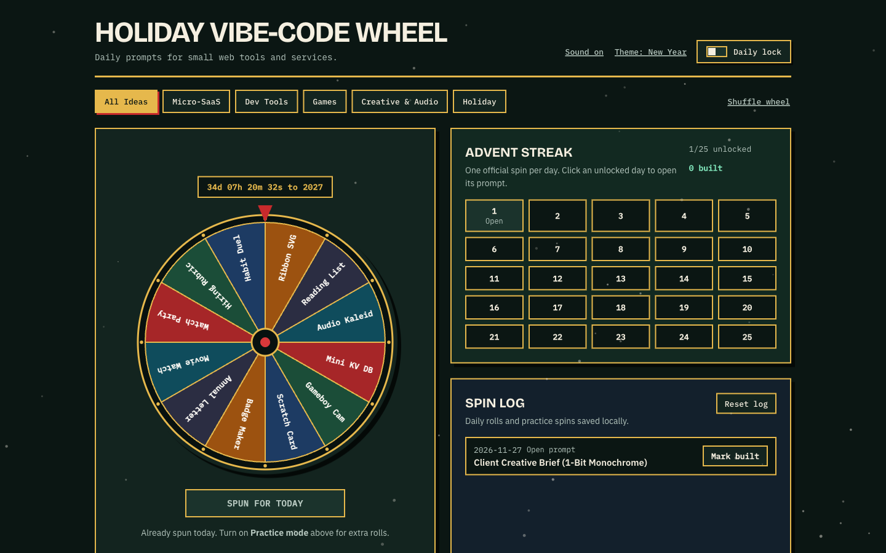
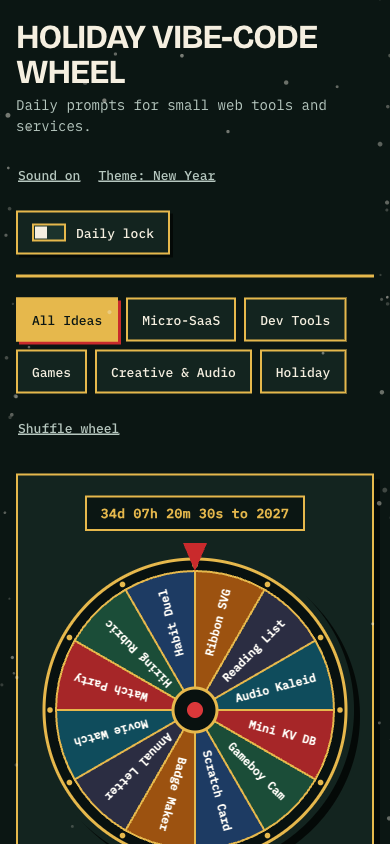

# Holiday Vibe-Code Wheel

A Neo-Brutalist daily spin-the-wheel web app for bite-sized coding prompts across **16,861** combinations (**904** base projects × **34** compatible product & aesthetic twists).

Live app: https://aa-blinov.github.io/holiday-vibe-code-wheel/

## Screenshots

### Desktop (1440×900)


### Mobile (390×844)


## Features

- **Fresh wheel on every spin**: Each spin deals 12 distinct ideas from the active category using an offscreen-cached HTML5 Canvas wheel (`easeOutCubic` physics, synced to display refresh rate).
- **6 non-overlapping categories**: *All Ideas*, *Micro-SaaS*, *Dev Tools*, *Games*, *Creative & Audio*, and *Holiday*.
- **Daily lock + Practice mode**: Track one official spin per day across rolling 25-day streak cycles in `localStorage`, or switch to *Practice mode* for unlimited rolls (`Space` to spin).
- **Direct AI launch & sharing**: Read the full prompt before copying, open it directly in **ChatGPT** or **Claude**, share a direct `?idea=...` link, attach your live build URL, and export your completed log.
- **Synthesized WebAudio feedback**: Warm wooden peg clicks and a major-9th landing chime (with a `Sound on/off` toggle).
- **3 Neo-Brutalist themes**: *New Year* (auto-selected Nov 15 – Jan 10), *Dark* (default the rest of the year), and *Light*, with a live seconds countdown to New Year.

## Local Development

```bash
npm install
npm run dev
```

Build for production:

```bash
npm run build
npm run preview
```

## Project Structure

- `src/data/challenges.js` — 904 base ideas, 34 compatible twists, category filtering, and O(1) sampling
- `src/components/SpinWheel.jsx` — Offscreen-cached HTML5 Canvas wheel with mechanical pointer flick
- `src/components/AdventStrip.jsx` — Rolling 25-day streak grid and Markdown log exporter
- `src/components/HistoryPanel.jsx` — Local spin log with built toggles and live build links
- `src/components/CatalogPanel.jsx` — Searchable directory across all 16,861 combinations
- `src/components/ChallengeModal.jsx` — Prompt preview, AI launch links, share, and build URL input
- `src/utils/sound.js` — Web Audio API click & chime synthesizer
- `src/utils/confetti.js` — Lightweight Canvas confetti burst
- `.github/workflows/deploy.yml` — Automated GitHub Pages deployment

## License

[MIT](./LICENSE)
